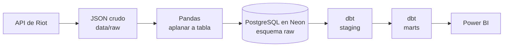

# 🎮 LoL Analytics Pipeline

Pipeline de datos de punta a punta para analizar mi rendimiento en League of Legends: ingesta desde la API de Riot, almacenamiento en PostgreSQL, modelado con dbt y dashboard en Power BI.


## 📌 Contenido

- [Preguntas que responde](#-preguntas-que-responde)
- [Arquitectura](#-arquitectura)
- [Stack](#-stack)
- [Modelo de datos](#-modelo-de-datos)
- [Decisiones de diseño](#-decisiones-de-diseño)
- [Hallazgos](#-hallazgos)
- [Cómo correrlo](#-cómo-correrlo)
- [Limitaciones y siguientes pasos](#-limitaciones-y-siguientes-pasos)

## ❓ Preguntas que responde

✍️ *Escríbelas con tus palabras, 3 o 4 viñetas. Por ejemplo:*

- ¿Con qué campeones y en qué roles me va mejor?
- ¿Mi rendimiento cambia de un mes a otro?
- ¿Cuántas partidas necesito para que un winrate sea confiable?

## 🏗️ Arquitectura



## 🧰 Stack

| Herramienta | Para qué se usa |
|---|---|
| Python 3.11 (`requests`) | Ingesta desde la API de Riot, con manejo de límites de peticiones y reintentos |
| Pandas | Aplanar el JSON anidado a una fila por jugador por partida |
| PostgreSQL (Neon) | Almacenamiento: capa `raw` cargada desde Python |
| dbt | Limpieza y modelado en capas, con pruebas de calidad |
| Power BI | Dashboard sobre las tablas `marts` |
| DBeaver | Validación de resultados con SQL |

## 🗂️ Modelo de datos

| Modelo | Capa | Descripción |
|---|---|---|
| `raw.match_participants` | raw | Una fila por jugador por partida, tal como llegó de la API |
| `stg_match_participants` | staging (vista) | Excluye remakes y calcula el KDA |
| `fct_my_matches` | marts (tabla) | Una fila por partida mía |
| `mart_champion_stats` | marts (tabla) | Partidas, winrate, KDA y kills por campeón |
| `mart_role_stats` | marts (tabla) | Partidas, winrate y KDA por rol |
| `mart_monthly_stats` | marts (tabla) | Partidas, winrate y KDA por mes |

13 pruebas de dbt (`not_null`, `unique`, `accepted_values` y una prueba propia de unicidad por jugador y partida).

## 🧠 Decisiones de diseño

- **Datos crudos intactos.** El JSON de Riot se guarda tal cual, y la tabla `raw` no se modifica. La limpieza vive en dbt, versionada y con pruebas.
- **Remakes excluidos con dos criterios.** El flag `gameEndedInEarlySurrender` de Riot más una duración mínima de 10 minutos, porque descubrí una partida fantasma de ~5 minutos que el flag no atrapaba.
- **Ingesta idempotente.** Se puede repetir sin duplicar datos ni gastar peticiones: salta lo que ya existe y reintenta con espera creciente ante fallos de red o límites de la API.
- **Validación cruzada.** Las cifras clave (95 partidas, winrate de 46,3 %, KDA de 2,59) dan lo mismo en Pandas, SQL y Power BI.
- **Sin secretos en el repo.** Las credenciales y mi identificador de jugador salen de variables de entorno.

## 🔍 Hallazgos

✍️ *Estos son los datos que ya tienes. Redacta tú la conclusión de cada uno, con su salvedad de muestra.*

- **Jinx:** 13 partidas, 77 % de winrate. → *¿Qué dice y qué no dice esa muestra?*
- **Octubre vs. noviembre:** 81 partidas con ~51 % frente a 14 partidas con ~21 %, y en noviembre casi no jugué Bot Lane. → *¿Por qué no se puede afirmar una causa?*
- **Rol principal vs. campeón estrella:** mi rol más jugado es JUNGLE (43 partidas), pero mi campeón con mejor resultado es de BOTTOM. → *¿Cómo lo contarías?*

## ▶️ Cómo correrlo

Requisitos: Python 3.11, una cuenta de [Riot Developer](https://developer.riotgames.com) y una base PostgreSQL (por ejemplo, Neon).

1. Clona el repo y crea el entorno:
   ```powershell
   python -m venv .venv
   .venv\Scripts\Activate.ps1
   pip install -r requirements.txt
   ```
2. Copia `.env.example` a `.env` y completa las variables: `RIOT_API_KEY`, `PUUID` y las `PG...` de tu base. La key de desarrollo de Riot **vence cada 24 horas**.
3. Ingesta y carga:
   ```powershell
   python src/ingest_matches.py
   python src/load_to_postgres.py
   ```
4. Carga el `.env` en la sesión (dbt no lo lee solo) y corre dbt:
   ```powershell
   Get-Content .env | ForEach-Object { if ($_ -match '^\s*([^#=]+?)\s*=\s*(.*)$') { Set-Item -Path "Env:$($matches[1])" -Value $matches[2] } }
   cd lol_analytics
   dbt run
   dbt test
   ```

## ⚠️ Limitaciones y siguientes pasos

- Muestra pequeña (95 partidas en un mes): los winrates por campeón con pocas partidas son ruido.
- La capa `raw` guarda también los nombres de los otros jugadores de cada partida. El dashboard no los expone.
- Pendiente: automatizar la ingesta (la key de desarrollo vence a diario) y ampliar el historial.
- Pendiente: un segundo análisis con datos de Millonarios FC.

---

*Este proyecto no está respaldado por Riot Games y no refleja las opiniones de Riot Games ni de nadie involucrado oficialmente en la producción o gestión de League of Legends. League of Legends y Riot Games son marcas registradas de Riot Games, Inc.*
