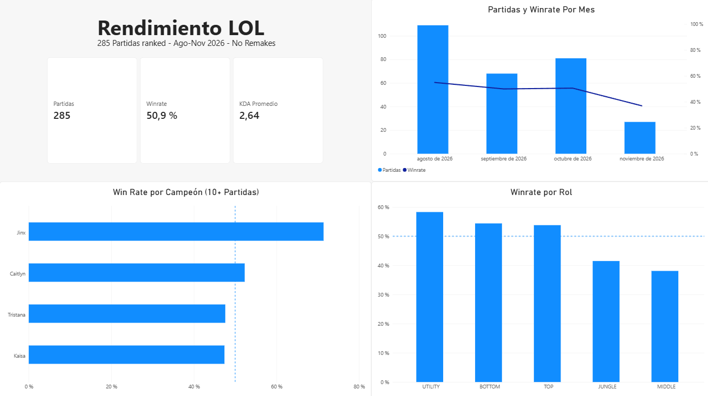
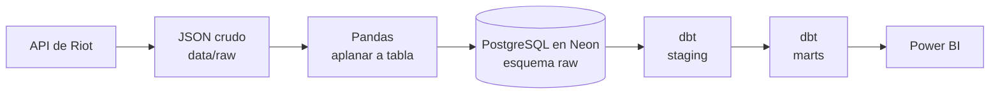

# 🎮 LoL Analytics Pipeline

Pipeline de datos de punta a punta para analizar mi rendimiento en League of Legends: ingesta desde la API de Riot, almacenamiento en PostgreSQL, modelado con dbt y dashboard en Power BI.




## 📌 Contenido

- [Preguntas que responde](#-preguntas-que-responde)
- [Arquitectura](#-arquitectura)
- [Stack](#-stack)
- [Modelo de datos](#-modelo-de-datos)
- [Decisiones de diseño](#-decisiones-de-diseño)
- [Hallazgos](#-hallazgos)
- [Cómo correrlo](#-cómo-correrlo)
- [Limitaciones y siguientes pasos](#-limitaciones-y-siguientes-pasos)

## ❓ Preguntas que responde

1. ¿Con qué campeones y en qué roles obtengo mejores resultados?
2. ¿Cómo evoluciona mi rendimiento de un mes a otro?
3. ¿Cuántas partidas se necesitan para confiar en el winrate de un campeón?

### Contexto del jugador

Los datos son de una sola cuenta y conviene leerlos con este contexto:

- Casi siempre juego acompañado: en dúo en la línea inferior (BOTTOM), como ADCarry. Los demás roles los uso para probar campeones y líneas, o cuando jugamos varios amigos.
- Caitlyn es mi campeón favorito y el más jugado.
- Dedico pocas horas al juego, y mi disponibilidad cambia con la época de la universidad (parciales y trabajos).
- El parche de cada temporada vuelve algunos campeones muy fuertes o muy débiles, y eso afecta el winrate. Este análisis no lo controla todavía.

## 🏗️ Arquitectura



## 🧰 Stack

| Herramienta | Para qué se usa |
|---|---|
| Python 3.11 (`requests`) | Ingesta desde la API de Riot, con manejo de límites de peticiones y reintentos |
| Pandas | Aplanar el JSON anidado a una fila por jugador por partida |
| PostgreSQL (Neon) | Almacenamiento: capa `raw` cargada desde Python |
| dbt | Limpieza y modelado en capas, con pruebas de calidad |
| Power BI | Dashboard interactivo sobre `fct_my_matches`, con medidas DAX (winrate y partidas) |
| DBeaver | Validación de resultados con SQL |

## 🗂️ Modelo de datos

| Modelo | Capa | Descripción |
|---|---|---|
| `raw.match_participants` | raw | Una fila por jugador por partida, tal como llegó de la API |
| `stg_match_participants` | staging (vista) | Excluye remakes y calcula el KDA |
| `fct_my_matches` | marts (tabla) | Una fila por partida mía. Es la tabla que alimenta el dashboard |
| `mart_champion_stats` | marts (tabla) | Partidas, winrate, KDA y kills por campeón |
| `mart_role_stats` | marts (tabla) | Partidas, winrate y KDA por rol |
| `mart_monthly_stats` | marts (tabla) | Partidas, winrate y KDA por mes |

El dashboard se calcula con medidas DAX sobre `fct_my_matches` para que todos los gráficos se filtren entre sí. Los marts agregados sirven como referencia: las cifras del dashboard deben coincidir con ellos.

13 pruebas de dbt (`not_null`, `unique`, `accepted_values` y una prueba propia de unicidad por jugador y partida).

## 🧠 Decisiones de diseño

- **Datos crudos intactos.** El JSON de Riot se guarda tal cual, y la tabla `raw` no se modifica. La limpieza vive en dbt, versionada y con pruebas.
- **Remakes excluidos con dos criterios.** El flag `gameEndedInEarlySurrender` de Riot más una duración mínima de 10 minutos, porque descubrí una partida fantasma de ~5 minutos que el flag no atrapaba.
- **Ingesta idempotente.** Se puede repetir sin duplicar datos ni gastar peticiones: salta lo que ya existe y reintenta con espera creciente ante fallos de red o límites de la API.
- **Validación cruzada.** Las cifras clave (285 partidas, 50,9 %, KDA 2,64) dan lo mismo en Pandas, SQL y Power BI.
- **Sin secretos en el repo.** Las credenciales y mi identificador de jugador salen de variables de entorno.

## 🔍 Hallazgos

- **Caitlyn y el efecto de la muestra.**
  **Dato:** su winrate pasó de 20 % con 5 partidas a 52 % con 44.
  **Qué sí dice:** los porcentajes con pocas partidas no son confiables.
  **Qué no dice:** que Caitlyn sea mejor o peor que otros campeones, porque el 52 % está dentro del margen de error de un 50 %.
- **Roles y contexto.**
  **Dato:** BOTTOM concentra 160 de 285 partidas (56 %), con 54 % de victorias, frente a JUNGLE (41,5 %, 53 partidas) y MIDDLE (38 %, 21 partidas).
  **Qué sí dice:** BOTTOM es el rol en el que más he jugado, con resultados por encima del 50 %.
  **Qué no dice:** que sea peor en los otros roles. En BOTTOM juego casi siempre en dúo, y los demás roles los uso para probar campeones, líneas o jugar con amigos, así que el rol y el contexto de juego están mezclados.
- **Noviembre.**
  **Dato:** ~37 % de victorias en 27 partidas, contra 50-55 % de agosto a octubre.
  **Qué sí dice:** una tendencia a vigilar.
  **Qué no dice:** una causa, porque 27 partidas no alcanzan para separar una mala racha de un cambio real.
- **Jinx.**
  **Dato:** 71 % de victorias en 14 partidas, el más alto entre los campeones con 10 o más partidas.
  **Qué sí dice:** un buen resultado que vale la pena seguir.
  **Qué no dice:** que sea mi mejor campeón. Con 14 partidas, el rango plausible va de ~50 % a ~95 %.

## ▶️ Cómo correrlo

Requisitos: Python 3.11, una cuenta de [Riot Developer](https://developer.riotgames.com) y una base PostgreSQL (por ejemplo, Neon).

1. Clona el repo y crea el entorno:
   ```powershell
   python -m venv .venv
   .venv\Scripts\Activate.ps1
   pip install -r requirements.txt
   ```
2. Copia `.env.example` a `.env` y completa `RIOT_API_KEY` y las variables `PG...` de tu base. La key de desarrollo de Riot **vence cada 24 horas**.
3. Obtén tu PUUID: edita `GAME_NAME` y `TAG_LINE` en `src/get_puuid.py`, corre `python src/get_puuid.py` y copia el valor de `puuid` a la variable `PUUID` del `.env`.
4. Ingesta y carga:
   ```powershell
   python src/ingest_matches.py
   python src/load_to_postgres.py
   ```
5. Carga el `.env` en la sesión (dbt no lo lee solo) y corre dbt:
   ```powershell
   Get-Content .env | ForEach-Object { if ($_ -match '^\s*([^#=]+?)\s*=\s*(.*)$') { Set-Item -Path "Env:$($matches[1])" -Value $matches[2] } }
   cd lol_analytics
   dbt run
   dbt test
   ```

## ⚠️ Limitaciones y siguientes pasos

- **Tamaño de muestra.** 285 partidas entre agosto y noviembre de 2026 alcanzan para tendencias generales, pero los porcentajes por campeón, rol o mes con pocas partidas son ruido. Para un winrate cercano al 50 %, el margen de error (95 %) es de unos ±25 puntos con 15 partidas, ±14 con 50 y ±10 con 100. El filtro de 10+ partidas del dashboard es un umbral para mostrar datos, no de confiabilidad.
- **Rol y contexto mezclados.** El rol cambia junto con las condiciones de juego (dúo en BOTTOM, solo o de prueba en los demás), así que no se pueden comparar roles de forma limpia.
- **Sin control de parche ni de rango.** Una sola cuenta, sin ajustar por el parche del juego.
- **Privacidad.** La capa `raw` guarda también los nombres de los otros jugadores de cada partida. El dashboard no los expone.
- **Siguientes pasos:**
  - Comparar el rendimiento con y sin mi dúo habitual (requiere guardar el equipo de cada jugador).
  - Guardar la versión del juego (`gameVersion`) para analizar el efecto del parche.
  - Automatizar la ingesta (la key de desarrollo vence a diario).
  - Un segundo análisis con datos de Millonarios FC.

---

*Este proyecto no está respaldado por Riot Games y no refleja las opiniones de Riot Games ni de nadie involucrado oficialmente en la producción o gestión de League of Legends. League of Legends y Riot Games son marcas registradas de Riot Games, Inc.*
